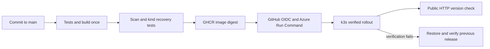

# How the project works

## Container image, tag and digest

An image packages the application and its runtime. A tag is a name for an image and can be reassigned, even if the name contains a Git commit. A registry digest identifies the published content.

The build writes the actual source commit into `/app/build-info.json`. The app reads that file; changing `APP_VERSION` cannot pretend to deploy another source version. Local unbuilt source explicitly reports `development`.

In GitHub, a candidate is built once, tested and scanned. Its Docker archive is transferred to the publish job, which pushes it without another build. A unique tag includes the commit, run and attempt. Persistent releases consume the resolved `ghcr.io/...@sha256:...` reference.

Docker and dependency pins improve repeatability, but do not by themselves guarantee bit-for-bit reproducible builds. The runtime dependencies are locked with hashes and the base image is pinned by digest.

## CI versus persistent deployment

Pull requests run application tests, image checks and a temporary kind cluster test. That cluster is an integration-test environment. It disappears after the job.

Merges to main additionally publish the image. The optional persistent job updates an existing cluster instead of creating a new one. Until that job is configured, the project has verified integration and publishing, but no persistent cloud application.

For this Azure assessment, the persistent target is a dedicated VM running k3s. GitHub exchanges its temporary OIDC identity for Azure access scoped to that VM, then uses Run Command to start the release. The VM generates a short-lived Kubernetes service-account token locally. The cluster administrator configuration never leaves the VM.

Public requests enter nginx on port 80, reach the private NodePort Service, then go to a ready app pod. Only port 80 is publicly allowed. Two pods share one VM, so this is not protection against VM failure. The local nginx route is checked within the promotion/rollback transaction; an independent public check runs from GitHub afterward. Azure's API accepting a command does not mean the guest release succeeded: the pipeline checks a compact guest report and exit-code marker as well.

## Readiness, liveness and rollout

Readiness `/health` controls whether a pod is eligible for Service traffic. Liveness `/live` checks whether the process responds. A demo readiness failure therefore does not create a liveness restart loop.

The Deployment uses two replicas, no planned unavailable replicas during rolling update, one extra pod, a short readiness-stabilization period, graceful shutdown and a five-second drain delay. These choices reduce planned interruption; network behavior and node failures can still cause request loss.

A rollout timeout only reports failure. Kubernetes does not automatically undo the rollout for this project. Our release command restores the saved previous Deployment spec, waits for it, then checks the Service's expected source version.

## Recovery states

- `succeeded`: rollout and Service verification passed; the verified state was recorded.
- `failed_preflight`: credentials, lock, drift or baseline checks failed before a candidate deployment.
- `failed_rolled_back`: the candidate failed; the prior release was restored and verified. Exit code remains 1.
- `failed_first_deployment`: there was no previous release; the failed candidate was removed. Exit code 1.
- `failed_recovery`: restoration could not be verified. Exit code 2 and human intervention is needed.

The release ConfigMap records the last verified image/version. A separate ConfigMap provides an atomic, namespace-scoped lock to prevent overlapping manual and CI release commands. Both require inspection after a runner is abruptly interrupted.

## Evidence and traffic measurements

Port-forwarding a Service chooses a pod behind it. When that pod exits, the forward can break independently of Service availability. Our measurement uses the stable NodePort and runs until the release command completes, plus a final observation interval.

The measurement records request count, failures, observed versions, elapsed duration and actual request rate. A failed request or unexpected command exit makes the measurement fail. A controlled failed release expects exit 1, while recovery failure exit 2 is never accepted as successful demonstration.

Scan-policy fixture tests simulate findings; they are not evidence of a scanner discovering a real vulnerability. Actual scan JSON is retained separately.

## Official references

- [Docker test-before-push](https://docs.docker.com/build/ci/github-actions/test-before-push/)
- [Kubernetes Deployments and failed rollouts](https://kubernetes.io/docs/concepts/workloads/controllers/deployment/)
- [kubectl port-forward behavior](https://kubernetes.io/docs/reference/kubectl/generated/kubectl_port-forward/)
- [Trivy vulnerability scanning](https://trivy.dev/latest/docs/guide/scanner/vulnerability/)
- [GHCR package visibility](https://docs.github.com/en/packages/working-with-a-github-packages-registry/working-with-the-container-registry)
